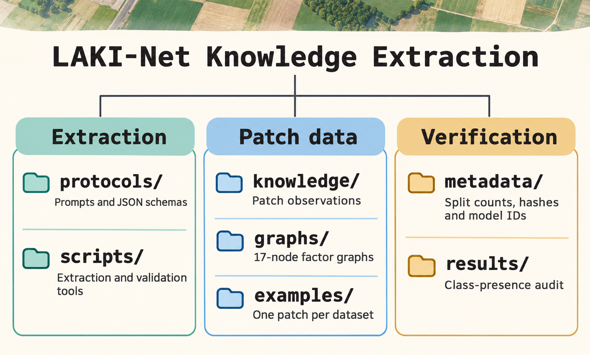
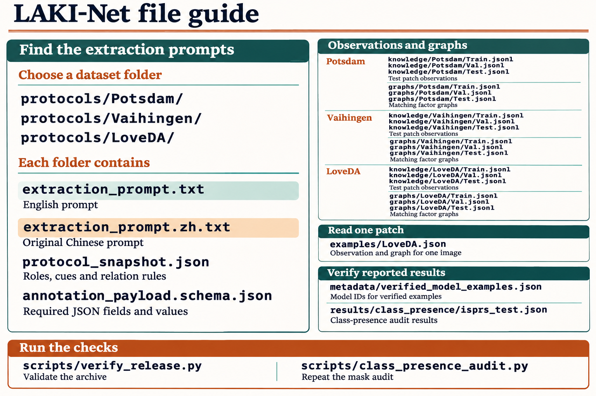

# LAKI-Net image-conditioned knowledge

This repository contains the knowledge used by LAKI-Net for remote sensing segmentation. Each of the **2,678 source patches** has a structured observation record and a matching 17-node factor graph. All crops from a patch share that record. The extraction model included `gpt-5.6-sol`. [Verified extraction examples](metadata/verified_model_examples.json)

**Start with one patch.** The LoveDA example shows how a model can report a tree and a hard surface in the same image without asserting that one occludes the other. [Read the worked example](examples/README.md)

## Repository guide



<details>
<summary>Show the detailed file map</summary>



Each dataset has separate training, validation and test records under `knowledge/`, with matching filenames under `graphs/`.

</details>

## Data and prompts

| Dataset | Train / Val / Test | Prompts | JSON Schema | Archived data | Example JSON |
|---|---:|---|---|---|---|
| Potsdam | 648 / 216 / 504 | [English](protocols/Potsdam/extraction_prompt.txt) · [Original Chinese](protocols/Potsdam/extraction_prompt.zh.txt) | [Schema](protocols/Potsdam/annotation_payload.schema.json) | [Records](knowledge/Potsdam/) · [Graphs](graphs/Potsdam/) | [RGB patch](examples/Potsdam.json) |
| Vaihingen | 73 / 24 / 113 | [English](protocols/Vaihingen/extraction_prompt.txt) · [Original Chinese](protocols/Vaihingen/extraction_prompt.zh.txt) | [Schema](protocols/Vaihingen/annotation_payload.schema.json) | [Records](knowledge/Vaihingen/) · [Graphs](graphs/Vaihingen/) | [NIR–red–green patch](examples/Vaihingen.json) |
| LoveDA | 770 / 110 / 220 | [English](protocols/LoveDA/extraction_prompt.txt) · [Original Chinese](protocols/LoveDA/extraction_prompt.zh.txt) | [Schema](protocols/LoveDA/annotation_payload.schema.json) | [Records](knowledge/LoveDA/) · [Graphs](graphs/LoveDA/) | [RGB patch](examples/LoveDA.json) |

LoveDA uses the paper's split of 1,100 images from its official training set. Each JSON Lines file contains one sample per line. Match records and graphs using `dataset`, `split` and `id` together. The English prompts are translations of the Chinese prompts used for extraction. [Original prompts, schemas and parsing rules](protocols/README.md)

## Validate the release

Run these commands from this directory with Python 3.11. The [dependency file](readme/requirements.txt) pins jsonschema 4.23.0, numpy 1.26.0 and Pillow 10.4.0. The check validates the released prompt and protocol checksums, the payloads against their schemas and semantic rules, and the alignment of record and graph IDs. It uses the archived files and requires no model access or source imagery.

```sh
python -m pip install -r readme/requirements.txt
python scripts/verify_release.py
```

The final line should read `Total: 2678 matched pairs`.

## What the reference masks verify

Across 617 Potsdam and Vaihingen test patches, **11 of 2,268 positive structural claims (0.49%)** had no valid pixel of the corresponding class in the same patch. The denominator counts claims across four roles. This check measures class presence anywhere in a patch. The reference masks do not establish the correctness of individual textures or spatial relations. [Results, flagged examples and reproduction commands](results/class_presence/README.md)

## File index

<details>
<summary>Browse all files by folder</summary>

### `protocols/` — What was the model asked to do?

Each dataset has its own instructions and response specification. The [protocol guide](protocols/README.md) explains how to prepare a request and parse the response.

For example, the original prompt for Potsdam is [`protocols/Potsdam/extraction_prompt.zh.txt`](protocols/Potsdam/extraction_prompt.zh.txt). Its English translation is [`protocols/Potsdam/extraction_prompt.txt`](protocols/Potsdam/extraction_prompt.txt). The same filenames are used in the [Vaihingen](protocols/Vaihingen/) and [LoveDA](protocols/LoveDA/) folders.

| File | Purpose | Potsdam | Vaihingen | LoveDA |
|---|---|---|---|---|
| `extraction_prompt.txt` | English translation for preparing a new request. | [Open](protocols/Potsdam/extraction_prompt.txt) | [Open](protocols/Vaihingen/extraction_prompt.txt) | [Open](protocols/LoveDA/extraction_prompt.txt) |
| `extraction_prompt.zh.txt` | Original Chinese instructions used to extract the archived observations. | [Open](protocols/Potsdam/extraction_prompt.zh.txt) | [Open](protocols/Vaihingen/extraction_prompt.zh.txt) | [Open](protocols/LoveDA/extraction_prompt.zh.txt) |
| `protocol_snapshot.json` | Image channels, allowed states, and the roles connected by each relation. | [Open](protocols/Potsdam/protocol_snapshot.json) | [Open](protocols/Vaihingen/protocol_snapshot.json) | [Open](protocols/LoveDA/protocol_snapshot.json) |
| `annotation_payload.schema.json` | Machine-readable constraints on the fields and values in a response. | [Open](protocols/Potsdam/annotation_payload.schema.json) | [Open](protocols/Vaihingen/annotation_payload.schema.json) | [Open](protocols/LoveDA/annotation_payload.schema.json) |

### `scripts/` — How can I prepare or check a record?

| Script | What it does |
|---|---|
| [make_request.py](scripts/make_request.py) | Prints the English instructions, protocol, schema and image ID for a patch. Attach the source image when submitting the request. |
| [payload_validator.py](scripts/payload_validator.py) | Decodes compact observations and checks consistency among roles, visual cues and relations. |
| [verify_release.py](scripts/verify_release.py) | Checks protocol hashes, response schemas, semantic rules, split counts and the pairing of records with graphs. |
| [class_presence_audit.py](scripts/class_presence_audit.py) | Compares positive structural claims with the classes present in the corresponding Potsdam or Vaihingen reference mask. |

### `knowledge/` and `graphs/` — Where are the paired observations and graphs?

Each line of a `knowledge/` file describes one source patch. The corresponding `graphs/` file represents its observations using five role nodes, eight visual cue nodes and four relation nodes. Match the two records by the full key `(dataset, split, id)`.

| Dataset | Split file | Observations | Factor graphs |
|---|---|---|---|
| Potsdam | `Train.jsonl` | [Records](knowledge/Potsdam/Train.jsonl) | [Graphs](graphs/Potsdam/Train.jsonl) |
| Potsdam | `Val.jsonl` | [Records](knowledge/Potsdam/Val.jsonl) | [Graphs](graphs/Potsdam/Val.jsonl) |
| Potsdam | `Test.jsonl` | [Records](knowledge/Potsdam/Test.jsonl) | [Graphs](graphs/Potsdam/Test.jsonl) |
| Vaihingen | `Train.jsonl` | [Records](knowledge/Vaihingen/Train.jsonl) | [Graphs](graphs/Vaihingen/Train.jsonl) |
| Vaihingen | `Val.jsonl` | [Records](knowledge/Vaihingen/Val.jsonl) | [Graphs](graphs/Vaihingen/Val.jsonl) |
| Vaihingen | `Test.jsonl` | [Records](knowledge/Vaihingen/Test.jsonl) | [Graphs](graphs/Vaihingen/Test.jsonl) |
| LoveDA | `Train.jsonl` | [Records](knowledge/LoveDA/Train.jsonl) | [Graphs](graphs/LoveDA/Train.jsonl) |
| LoveDA | `Val.jsonl` | [Records](knowledge/LoveDA/Val.jsonl) | [Graphs](graphs/LoveDA/Val.jsonl) |
| LoveDA | `Test.jsonl` | [Records](knowledge/LoveDA/Test.jsonl) | [Graphs](graphs/LoveDA/Test.jsonl) |

### `examples/` — What does a complete sample look like?

Each example contains both the observation payload and the graph for the same patch. Open a [Potsdam RGB patch](examples/Potsdam.json), a [Vaihingen false-color patch](examples/Vaihingen.json) or a [LoveDA RGB patch](examples/LoveDA.json). The [walkthrough](examples/README.md) explains how to read an observed structure, a visual cue and a spatial relation in the LoveDA example.

### `metadata/` — How can I check the archive?

| File | What it records |
|---|---|
| [split_counts.json](metadata/split_counts.json) | Number of source patches in each dataset and split. |
| [protocol_sha256.json](metadata/protocol_sha256.json) | SHA-256 checksums for both prompt languages, the protocol snapshots and the schemas. |
| [verified_model_examples.json](metadata/verified_model_examples.json) | Sample-level model IDs, source hashes and timestamps for the verified examples. |

### `results/class_presence/` — Which claims were checked against masks?

The [audit guide](results/class_presence/README.md) defines the four structural roles compared with reference masks and gives the reproduction commands. The [results JSON](results/class_presence/isprs_test.json) contains counts by dataset and role, plus the individual flagged claims. This check covers class presence across 617 Potsdam and Vaihingen test patches.

### README assets and repository settings

The [overview](readme/repository-overview.png), [detailed file map](readme/repository-map.png) and [Python requirements](readme/requirements.txt) are stored in `readme/`. Git preserves the protocol file bytes according to [.gitattributes](.gitattributes) and excludes Python caches and the local virtual environment according to [.gitignore](.gitignore).

</details>
